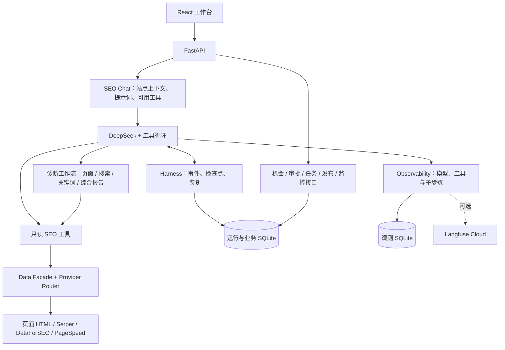

# SEO Diagnosis Agent

一个网站 SEO 诊断 Agent MVP。用户用自然语言提问，DeepSeek 根据问题和已有证据选择工具、决定是否继续查询，最后整理结论。代码负责限制执行次数、处理超时并保存运行过程。项目使用 Python、FastAPI、React 和 SQLite。

## 受控的工具循环

Agent 的核心不是「能调工具」，是**知道什么时候停**。三条约束写死在代码里，不依赖提示词自觉：

| 约束 | 位置 | 值 |
|---|---|---|
| 单次调查工具调用上限 | `AgentLoop.max_tool_calls` | 12 |
| 单次工具超时 | `AgentLoop.tool_timeout` | 15s |
| 重复调用检测 | `_DUPLICATE_GUARD_PREFIX` | 命中即停，改为基于已有证据作答 |

到达预算不是静默截断：循环切换到总结模式，只基于已获得的证据作答，并必须输出「已确认结论 / 关键证据 / 数据不足或失败项 / 下一步建议」四段，不得继续补查、不得编造数据。

## Agent 如何运行

[SEO Chat 入口](src/api/routes/seo_agent_chat.py)读取站点信息，构建[系统提示词](src/seo_agent/chat/runtime.py)和可用工具，再交给[工具循环](src/agent/loop.py)执行。模型负责选择查询和解读结果；页面体检、关键词研究和综合报告等步骤由工作流代码组织。



对话工具全部只读，不会修改网站、创建执行任务或发布内容。后续业务操作通过各自的接口和审批规则执行。

## 业务场景与现有入口

下面按业务问题说明已有代码能支撑什么；工具组合取决于模型判断、数据源配置和本次查询结果。

| 业务场景与输入示例 | 实际工具或服务 | 产出与当前状态 |
| --- | --- | --- |
| 页面体检：“检查首页 SEO，也看看性能。” | `seo_site_audit` → `seo_page_metadata`，按需调用 `seo_page_performance` | 页面元信息和可选性能证据；已封装为单页工作流 |
| 页面信息建议：“根据这一页的内容，帮我拟定标题、描述、分享信息和结构化数据。” | `seo_page_suggestions` → 页面事实、模型草稿、引用校验、缺失信息追问 | 给出 TDK、OG、JSON-LD 建议；用户补充后沿用对话继续生成，不修改网站 |
| 搜索现状：“看看本站目前有哪些关键词和排名。” | `seo_search_diagnosis` → `seo_search_metrics` + `seo_organic_keywords` | 站点指标、有限排名样本和对应页面；已封装为工作流，不提供历史下降归因 |
| 关键词机会：“围绕企业名录，有哪些关键词值得研究？” | `seo_keyword_opportunity` → 联想词、批量关键词指标、输入主题的 SERP | 去重后的候选词和可用指标；已封装为工作流，缺失指标保持未知 |
| 机会生成与入池：显式提交一次机会发现请求 | `OpportunityDiscoveryWorkflow` → 关键词研究、冻结快照、模型候选、证据校验、既有入池服务 | 生成至多 3 个机会并沿用原有评分和审批策略；独立业务接口触发，不是只读 Chat 工具 |
| 已有排名页优化：“哪些已有排名的页面值得进一步检查？” | `seo_ranking_page_optimization` → 排名样本、少量站内 HTML、每页一个代表词 SERP | 默认调查第 4–20 名样本中的 2 个站内页面，输出实际标签、搜索证据和待核实项；不修改页面 |
| 页面变更复检：“按之前的快照，检查 Title、H1 和 Canonical 是否符合目标。” | `seo_page_change_review` → 本站基线、重新读取页面、冻结新快照、逐项比较 | 输出变更明细和验收结论；先显式建立基线，缺少目标值或完整证据时不判定通过 |
| 竞品分析：“谁在和本站竞争这些搜索词？” | `seo_site_diagnosis` 的可选竞品步骤，或 `seo_organic_competitors`、`seo_serp_overview` | 自然搜索竞品、交集指标及指定关键词的搜索结果，不代表完整关键词差距 |
| 站点综合诊断：“诊断本站，并研究企业名录相关机会。” | `seo_site_diagnosis` → 页面体检、搜索现状、指定主题的关键词机会，按需读竞品 | 结构化卡片报告、证据和检查覆盖范围；已封装为组合工作流 |
| 已批准机会任务规划：显式提交已批准机会与负责人 | `TaskPlanningWorkflow` → 校验最新审批、生成 PRD 内容、原子写入任务和文档记录 | 创建草稿任务、PRD 和本地 Markdown/PDF；支持幂等重试，不自动派发或发布 |
| 交付审核：提交交付后，按对应 PRD 检查 | [`review_delivery`](src/seo_agent/workflows/task_delivery.py) | 模型生成通过项、失败项和修改意见，再由服务校验并记录审核；通过后仍需走发布规则 |

只读关键词工作流产出研究候选与证据，不会写入业务机会。显式调用机会发现接口后，才会生成并校验 `OpportunityCandidate`、进入既有机会池；两条路径都不会批准机会、创建任务或发布。搜索表现来自第三方数据源，不能据此冒充 GSC/GA4 的实际访问量或完整下降归因。

## 工具与业务工作流

[`src/seo_agent/chat/tools.py`](src/seo_agent/chat/tools.py) 定义了 16 个基础数据工具，并按依赖注册最多 7 个只读组合工作流。正式对话只使用 `live_capabilities` 支持的工具；实际可用数量取决于配置和数据源状态。

| 分组 | 工具 | 数据来源 |
| --- | --- | --- |
| 页面 | `seo_page_metadata`、`seo_page_performance` | 页面源 HTML、PageSpeed |
| 搜索表现 | `seo_search_metrics`、`seo_organic_keywords` | DataForSEO |
| SERP 与关键词 | `seo_serp_overview`、`seo_keyword_overview`、`seo_autocomplete` | Serper / DataForSEO；关键词指标需要 DataForSEO |
| 竞品与外链 | `seo_organic_competitors`、`seo_backlinks_list` | DataForSEO |
| 新闻、图片、视频 | `seo_news_search`、`seo_image_search`、`seo_video_search` | Serper |
| 当前不可用于正式对话 | `seo_search_history`、`seo_top_pages`、`seo_site_profile`、`seo_audit_issues` | 当前仅由 pseudo 模式的 Ahrefs 提供 |

业务工作流代码位于 [`src/seo_agent/workflows/`](src/seo_agent/workflows/)：

| 代码 | 入口 | 业务职责 |
| --- | --- | --- |
| [`site_audit.py`](src/seo_agent/workflows/site_audit.py) | `seo_site_audit` | 保留现有入口，读取单页元信息和可选 PageSpeed 数据 |
| [`page_suggestions.py`](src/seo_agent/workflows/page_suggestions.py) | `seo_page_suggestions` | 依据页面和用户补充拟定 SEO 信息，校验引用，追问必要缺项并继续生成建议 |
| [`search_diagnosis.py`](src/seo_agent/workflows/search_diagnosis.py) | `seo_search_diagnosis` | 汇总站点指标与排名关键词，保留当前快照和来源 |
| [`keyword_opportunity.py`](src/seo_agent/workflows/keyword_opportunity.py) | `seo_keyword_opportunity` | 围绕用户主题，组合联想词、候选词指标与主题 SERP |
| [`ranking_page_optimization.py`](src/seo_agent/workflows/ranking_page_optimization.py) | `seo_ranking_page_optimization` | 从排名样本选少量站内页面，核对 HTML、代表词 SERP 和可选性能证据 |
| [`page_change_review.py`](src/seo_agent/workflows/page_change_review.py) | `seo_page_change_review` | 为本站页面建立基线，重新读取同一页面并核对明确的验收值 |
| [`site_diagnosis.py`](src/seo_agent/workflows/site_diagnosis.py) | `seo_site_diagnosis` | 汇总代表页面、搜索现状、可选关键词和竞品证据，形成报告 |
| [`opportunity_discovery.py`](src/seo_agent/workflows/opportunity_discovery.py) | `OpportunityDiscoveryWorkflow.execute` | 冻结研究证据、生成候选并校验后，原子执行既有入池和审批请求处理；仅由业务接口调用 |
| [`task_planning.py`](src/seo_agent/workflows/task_planning.py) | `TaskPlanningWorkflow.execute` | 将已批准机会转成草稿任务与 PRD，原子记录结果并按幂等键复用回执；仅由业务接口调用 |
| [`task_delivery.py`](src/seo_agent/workflows/task_delivery.py) | `TaskDeliveryWorkflows.generate_prd` / `review_delivery` | 已有任务 PRD 生成和交付审核流程；通过业务接口调用，不注册为只读 Chat 工具 |

站点综合诊断的实际步骤如下；模型仍可单独选择其中一个流程或基础工具：

```text
seo_site_diagnosis
  ├─ seo_site_audit
  │   ├─ seo_page_metadata
  │   └─ seo_page_performance（仅用户要求性能时）
  ├─ seo_search_diagnosis（依赖可用时）
  │   ├─ seo_search_metrics
  │   └─ seo_organic_keywords
  ├─ seo_keyword_opportunity（指定 query 且依赖可用时）
  │   ├─ seo_autocomplete（可用时）
  │   ├─ seo_keyword_overview（一次批量指标查询，可用时）
  │   └─ seo_serp_overview（仅查询输入主题词）
  └─ seo_organic_competitors（仅用户要求竞品时）
```

关键词研究的 `limit` 默认 5、上限 10，主题词和联想词合并去重后受此数量限制；SERP 不会逐个核验所有候选词。综合诊断仅在提供 `query` 时研究关键词，性能和竞品步骤分别由 `include_performance`、`include_competitors` 显式开启。

组合工作流只有在具备必要 live 依赖时才注册：搜索现状需要站点指标和排名关键词；关键词研究需要 SERP 及联想词或关键词指标中的至少一种；综合诊断需要页面体检及搜索现状或关键词研究中的至少一种。

排名页优化需要排名关键词、页面元信息和 SERP 三种 live 能力。`limit` 默认读取 20 条排名样本、最多 50 条；`min_position` / `max_position` 默认 4 / 20；`max_pages` 默认 2、上限 3。相同页面去重，只取站内 HTTP(S) URL，每页查询一个代表词的 SERP；`include_performance=true` 时才检查性能。未找到匹配页只代表本次样本没有匹配，未核验页面不会被描述成已确认的优化问题。

搜索、关键词和综合诊断通过 `coverage` 记录步骤成功、失败、不可用或跳过，保留已取得的证据；受检步骤未完成时返回 `workflow_status=partial`，没有任何证据时返回失败。综合报告将 robots.txt、sitemap 和 Google 收录标为 `not_implemented`；`complete` 只表示已支持的本次受检范围完成，不代表整站爬取或收录审核。页面读取不执行 JavaScript。

### 页面 SEO 信息建议

在对话中提出“根据这个页面拟一份标题、描述、关键词、分享信息和结构化数据建议”即可；用户不需要选择工具或填写参数。此流程只需页面可访问和 DeepSeek 配置，不需要搜索数据服务的 Key。

流程读取当前页的标签、正文摘录和已有 JSON-LD，由模型理解页面实际用途并提出草稿。输入与输出由 [`PageSuggestionInput`、`PageSeoDraft`](src/models/page_suggestions.py) 的 JSON Schema 定义，JSON-LD 直接返回对象。模型使用 JSON Output，后端再校验字段格式、引用原文和 URL 来源，生成 TDK、OG、JSON-LD 与 HTML 片段。

缺少必要信息时进入 Human-in-the-loop：每次询问最多三个具体问题，将页面证据和待答问题保存到检查点，运行变为 `waiting_for_input`，停止继续调用模型。用户在同一对话中回答后，前端通过 `POST /api/v1/seo-agent/chat/runs/{run_id}/input` 提交符合 [`HumanInputAnswer`](src/agent/models.py) Schema 的回答，恢复同一 Run、Task 和 Thread；相同页面复用已保存的证据，调用预算不重置。回答、事件和检查点原子保存，同一请求重复提交复用回执，冲突回答拒绝；服务重启不会自动跳过等待。这个补充步骤不代表机会审批。

已有有效草稿时，用户也可选择“先用现有信息生成”（`action=use_available`）：未确认内容列为待补充，不再阻塞本轮建议；事实与格式校验仍执行。没有有效草稿的必要补充不能用这个选择跳过。

页面原文和用户补充分开标记。没有依据的价格、评分、日期、作者或图片不自动补齐；不能确认结构化类型时先保留可确定的文案并追问。没有执行 JavaScript，正文最多读取 6000 字符，对话补充最多使用最近 5 条用户输入、每条 2000 字符。HTML 片段保留在结果中，JSON-LD 在卡片展示；提示词、模型调用和引用校验可在运行记录中查看。

结果始终是待人工确认的建议，不修改外部网站、Canonical、审批或发布记录。已有 JSON-LD 需人工确认合并，不能直接覆盖。代码只做 JSON 结构与来源校验，尚未运行 Schema.org 词汇全量验证或 [Google 富结果测试](https://search.google.com/test/rich-results)。[Google 不使用 Meta Keywords 参与收录和排名](https://developers.google.com/search/docs/crawling-indexing/special-tags#unsupported)，关键词仅作为主题文案建议。

### 机会生成与入池

先为本站 `OPPORTUNITY_SCAN` 计划创建状态为 `RUNNING` 的扫描记录，再通过业务接口显式执行：

```text
POST /api/v1/seo-agent/scan-runs/{run_id}/discover-opportunities
```

```json
{
  "query": "企业名录",
  "changed_by_actor_id": "有效操作人 ID",
  "default_approver_actor_id": "可选的有效审批人 ID",
  "idempotency_key": "本次请求的唯一键",
  "max_opportunities": 3
}
```

站点范围由扫描记录决定，不能在请求中替换 `site_id`。流程复用关键词研究，将结果冻结到现有 SQLite 证据快照库，再由 DeepSeek 生成结构化候选。代码校验市场、关键词、竞品 URL 和快照引用；搜索量、难度使用首个关键词的实际指标，缺失时保持未知。模型可以明确返回空候选列表。

SERP 返回未解析的 Google 跳转地址时，原始快照照常保留，但跳转地址不作为竞品页面入库，竞品数量保持未知。

通过校验的批次复用现有归一化、去重和评分策略；评分因素由模型提出，最终分数由现有策略计算，不代表已经证实的收益。机会、观测、审批请求、通知队列、扫描完成状态及回执在一个业务事务内提交，中途失败或取消会整体回滚。相同扫描记录下，相同幂等键和请求内容复用已完成回执，不再次生成机会；同一键换内容会被拒绝。失败前的外部取数、模型调用或快照保存仍可能在重试时发生，不能据此承诺外部服务只调用一次。

成功落库后扫描记录变为 `COMPLETED`；失败时保持可重试的 `RUNNING`。提供 `default_approver_actor_id` 时，高价值机会沿用原服务创建待审批请求；未提供时只入池等待后续申请。中低价值机会仍进入机会池或观察状态。所有机会创建任务前仍须通过最新审批，接口不会自动批准、创建任务或发布。此流程与 PRD、交付审核共用[结构化模型调用与观测](src/seo_agent/workflows/structured_model.py)。

### 已批准机会 → 任务与 PRD

显式调用 `POST /api/v1/seo-agent/tasks/plan`，不通过只读 Chat 自动建任务：

```json
{
  "site_id": "有效站点 ID",
  "title": "关键词内容优化任务",
  "task_type": "ARTICLE",
  "priority": "HIGH",
  "opportunity_ids": ["已批准机会 ID"],
  "owner_actor_id": "有效负责人 ID",
  "created_by_actor_id": "有效操作人 ID",
  "idempotency_key": "plan-content-001"
}
```

每次至多选择 10 个不重复的本站机会。流程复用建任务服务的审批校验和现有 PRD 提示词：先检查站点、操作人及最新审批，生成并校验 PRD 内容；再在写入事务内重新校验审批，创建 `DRAFT` 任务、PRD、本地 Markdown/PDF 文档记录和完成回执。模型调用不占用数据库写事务，模型失败不创建任务，写入或文档生成失败时业务记录一起回滚。

相同站点下，同一幂等键和请求内容复用已完成结果，不重复建任务或增加 PRD 版本；换内容会被拒绝。跨实例并发请求可能重复调用模型，但事务内再次检查回执，业务记录只写入一份。流程不批准机会、不派发任务、不发布；原有单独建任务、生成 PRD 和交付审核接口继续可用。

### 页面变更复检

SEO Chat 可调用 `seo_page_change_review`；需要 live 页面 HTML 能力和已启动的本地快照库，无额外第三方 Key。先要求 Agent 为目标页面建立基线，工具参数为：

```json
{"action": "capture_baseline", "url": "https://example.com/guide"}
```

工具返回 `baseline_snapshot_id`，此时 `review_status=baseline_recorded`，只表示基线已保存。页面由人工或其他已授权流程修改后，再提供该 ID 和明确的目标值：

```json
{
  "action": "compare",
  "baseline_snapshot_id": "上一步返回的快照 ID",
  "expected": {
    "title": "Content Guide",
    "h1s": ["Content Guide"],
    "canonical_url": "https://example.com/guide"
  }
}
```

复检强制重新读取同一请求 URL，校验基线属于本站且为完整、成功的 `page_html` 证据，保存新快照并展示 Title、Description、H1、Canonical 的前后差异。`expected` 支持 `title`、`meta_description`、`h1s`、`canonical_url`，只逐项精确匹配显式提供的值；`canonical_url: null` 表示预期没有该标签。未提供目标的字段只展示差异，不擅自设定修改目标。

`review_status` 区分 `passed`、`failed`、`insufficient_evidence`；缺少验收值、采集失败或证据不完整时不会判定通过。旧快照不改写，复检不会修改网页或证明收录、排名提升。Langfuse 可查看基线读取、页面工具、新快照和逐项比较；任务规划则记录审批校验、实际 PRD 模型输入输出、原子写入及回执复用。

## 执行控制与恢复

以下默认值由代码执行约束，可通过环境变量调整，见 [`.env.example`](.env.example) 和 [`Settings`](src/core/config.py)。

| 约束 | 配置项 | 默认值 |
| --- | --- | --- |
| 模型循环轮次 | `AGENT_MAX_ITERATIONS` | 8 |
| 循环中的外层工具调用次数 | `AGENT_MAX_TOOL_CALLS` | 12 |
| 单次工具超时 | `AGENT_TOOL_TIMEOUT` | 15 秒 |

迭代预算的最后一轮禁用新工具，转入总结；同名同参的成功工具结果优先复用，随后转入总结。工具次数超限会使运行失败，工具超时则以失败结果交回模型。总结提示词要求说明结论、证据和数据限制，但没有强制校验回答格式或事实正确性。

一次组合工作流在外层计作一次工具调用，内部可能执行多个数据请求，次数不等于第三方接口用量或费用上限。内部步骤受候选数量、固定步骤范围和共享超时控制，实际调用会单独记录 span。

[`Harness`](src/agent/harness/) 保存事件和关键检查点，支持 SSE 重连与服务重启后恢复。已写入检查点的结果可复用；工具执行后、检查点落盘前中断，恢复时可能再次读取。诊断工作流内部子步骤共享外层调用超时，没有独立检查点。

## 业务操作与审批

- [机会管理](src/seo_agent/opportunities/)接收结构化 `OpportunityCandidate`，执行归一化、去重、评分和分级。新机会发现接口已串起研究和入池；[定时扫描](src/seo_agent/automation/schedules.py)仍只创建运行记录，尚未自动调用这条工作流。
- 创建任务时，所有关联机会必须属于当前站点，且最新的“将机会加入生产”审批已通过。中低价值机会不会自动发起审批，可通过审批接口手动创建，工作台尚无申请入口。[LangGraph 审批图](src/seo_agent/approvals/graph.py)已独立测试，尚未接入审批接口。
- [任务与交付工作流](src/seo_agent/workflows/task_delivery.py)中的 PRD 生成和交付审核包含模型调用；写入及状态变更由业务服务校验。[HTML 发布](src/seo_agent/publishing/)要求交付已审核、提交内容与审核内容一致，生产发布还需通过对应审批。
- [监控](src/seo_agent/monitoring/)已有计划、结果接入和采集器协议；当前没有真实收录采集器接入，不能描述成已完成自动发布后复检。完整业务链路仍需真实端到端验收。

## 配置与外部服务

按需将配置写入本地 `.env.local`，修改后重启后端。变量定义见 [`.env.example`](.env.example) 和 [`Settings`](src/core/config.py)；不要提交真实凭据。

| 服务 | 用途 | 配置变量 | 使用前提 |
| --- | --- | --- | --- |
| DeepSeek | 对话中的工具选择、结论整理、页面信息建议、机会候选生成，以及 PRD 生成和交付审核 | `DEEPSEEK_API_KEY`；可选 `DEEPSEEK_BASE_URL`、`DEEPSEEK_MODEL` | 需要 API 账号、有效 Key 和所选模型的可用调用额度；缺失 Key 时模型请求不可用 |
| 页面 HTML | 读取当前站点页面的源 HTML 和元信息 | 不需要第三方 Key | 当前运行环境能够访问目标公网页面，URL 属于当前站点；不执行 JavaScript |
| Serper | Google SERP、联想词、新闻、图片、视频搜索 | `SERPER_API_KEY` | 需要 Serper API 账号、有效 Key 和相应调用额度 |
| DataForSEO | 关键词指标、自然排名、竞品、外链及 SERP | `DATAFORSEO_LOGIN`、`DATAFORSEO_API_KEY` | 分别填写 API Access 提供的 login 和 API password（API 专用密码）；还需相应端点权限及可用余额或额度 |
| PageSpeed | 单页面 Lighthouse 实验室检查 | `PAGESPEED_API_KEY` | 本项目要求配置 PageSpeed API Key，且请求需满足对应 Google API 项目的权限、限制和配额 |
| Langfuse Cloud（可选） | 将模型和工具运行记录上传到项目 | `LANGFUSE_HOST`、`LANGFUSE_PUBLIC_KEY`、`LANGFUSE_SECRET_KEY` | 需要 Langfuse 项目及有写入权限的项目密钥，Host 与项目区域一致；不配置时保留本地记录 |

DataForSEO 的关键词和站点指标分别使用 [Keyword Overview](https://docs.dataforseo.com/v3/dataforseo_labs-google-keyword_overview-live/) 和 [Domain Rank Overview](https://docs.dataforseo.com/v3/dataforseo_labs-google-domain_rank_overview-live/)；可按官方文档核对端点权限与返回字段。

DataForSEO Labs 不覆盖所有国家和语言，使用前需核对 `dataforseo_labs/locations_and_languages` 的可用组合。不支持的市场会导致对应步骤失败，工作流保留其他可用证据，不自动改换市场；接口报错不能当作零搜索量或没有排名。

业务通知与发布还有各自的配置前提：

- [邮件通知](src/seo_agent/notifications/email.py)需要 `SMTP_HOST`、`SMTP_PORT`、`SMTP_SECURITY`、`SMTP_USERNAME`、`SMTP_AUTH_CODE` 和 `EMAIL_FROM_ADDRESS`；邮箱需开通 SMTP 并取得授权码，端口和加密方式应与邮箱服务匹配。
- [本地 HTML 发布](src/seo_agent/publishing/html_site.py)使用 `HTML_SITE_ROOT_PATH`、`HTML_SITE_BASE_URL` 和可选的 `HTML_SITE_CONTENT_SUBDIR`，不需要第三方 Key。发布目录须可写，并由用户配置的站点服务通过对应 Base URL 提供访问；文件落盘不等于线上地址已经可达。

未配置的数据源不进入正式对话的 live 工具列表。DataForSEO 的兼容 pseudo 数据也不会进入正式诊断；页面体检要求性能检查但 PageSpeed 未配置时，会保留页面证据并返回部分完成。

组合工作流可能连续请求多个外部接口；关键词研究按可用数据源安排一次批量指标查询和一次主题 SERP 查询，HTTP 重试还可能增加请求。请按所需流程配置数据源并查看服务方实际用量，`AGENT_MAX_TOOL_CALLS` 不限制工作流内部的接口请求总数。

填入凭据只说明本地配置已提供，不能证明远端已授权、相关 API 已开通或额度足够；这些状态应以实际接口响应为准，不能仅凭 `/health` 的客户端就绪状态判定。

## 本地启动

需要 Python 3.11+、Node.js 20.19+ 或 22.12+，以及 npm。自然语言诊断至少需要上表中的 DeepSeek 配置，其他数据源按需启用。

macOS / Linux 在仓库根目录运行：

```bash
sh start.sh
```

访问 `http://localhost:5173`，API 文档位于 `http://localhost:8000/docs`。脚本会复用已有虚拟环境和前端依赖；前端依赖变化时，可运行 `npm ci --prefix frontend`。

API 没有登录或鉴权，默认仅供本机使用，不要直接暴露到局域网或公网。

### Docker 启动后端

```bash
docker build -t seo-diagnosis-agent .
docker run --rm -p 127.0.0.1:8000:8000 -v seo-agent-data:/app/data seo-diagnosis-agent
```

镜像只包含后端，`seo-agent-data` 卷保存运行数据。容器不会自动读取宿主机的 `.env.local`：需要真实调用时，可创建不提交的 `.env.docker`，每行写 `KEY=value`（值不要加引号），并给 `docker run` 添加 `--env-file .env.docker`。

前端另开终端启动：

```bash
cd frontend
npm ci
npm run dev
```

未配置可选数据源或 Ahrefs 仍为 pseudo 模式时，`/health` 的总体状态可能为 `degraded`，可查看各数据源状态。

### 可选：Langfuse Cloud

在 `.env.local` 中配置 `LANGFUSE_HOST`、`LANGFUSE_PUBLIC_KEY` 和 `LANGFUSE_SECRET_KEY` 并重启后端。Host 需对应项目所在区域；未配置时仍使用本地 SQLite 记录。

云端记录每轮模型输入（包括用户问题和系统提示词）、可见回答、工具选择及输入输出、执行或复用、结束原因、状态、耗时和模型返回的 Token 用量。组合工作流还会展示实际执行的子流程与数据工具，PRD 和交付审核也保留模型调用记录。模型内部推理不在记录中。

记录可能包含站点和业务数据并发送到云端；常见凭据会脱敏，但不能保证识别所有敏感内容，超长内容会被截断。上传在后台进行，网络故障或程序过早关闭可能导致云端缺少记录，启用前的旧记录不会自动回填。

## 目前的边界

- 综合诊断覆盖代表单页和有限搜索样本；robots.txt、sitemap、Google 收录和完整历史仍未实现。机会入池通过独立接口显式触发，完整“诊断 → 机会审批 → 执行 → 复检”仍需真实端到端验收。
- 这是单机 MVP，SQLite 不适合多实例生产部署。[seo-audit-plugin](https://github.com/cheng-sir-0038/seo-audit-plugin) 是独立项目，本仓库尚未接入其 MCP，也不支持 GSC 或 GA4 数据源。

## 测试

```bash
.venv/bin/python -m pytest \
  tests/agent tests/agent_evals \
  tests/seo_agent/test_site_audit_workflow.py \
  tests/seo_agent/test_business_workflows.py \
  tests/seo_agent/test_opportunity_discovery_workflow.py \
  tests/seo_agent/test_ranking_page_optimization.py \
  tests/seo_agent/test_task_planning_workflow.py \
  tests/seo_agent/test_page_change_review.py \
  tests/seo_agent/test_page_suggestions.py \
  tests/providers/test_dataforseo_keyword_overview.py -q
```

前端验证：`npm --prefix frontend test`、`npm --prefix frontend run lint`、`npm --prefix frontend run build`；完整后端用例运行 `python -m pytest -q`。

[`tests/agent_evals/`](tests/agent_evals/)根据实际运行事件检查工具选择、失败和终态；自动化用例使用模拟模型，不代表 DeepSeek 的真实选工具准确率。新增诊断流程见[业务工作流用例](tests/seo_agent/test_business_workflows.py)，关键词接口字段见[DataForSEO 契约用例](tests/providers/test_dataforseo_keyword_overview.py)。其他业务用例可参阅[机会管理](tests/seo_agent/test_opportunities_workbench.py)、[任务与交付](tests/seo_agent/test_tasks_delivery.py)、[发布与监控](tests/seo_agent/test_publishing_monitoring.py)和[自动化集成](tests/seo_agent/test_automation_integration.py)。

本项目采用 [MIT 许可证](LICENSE)。
