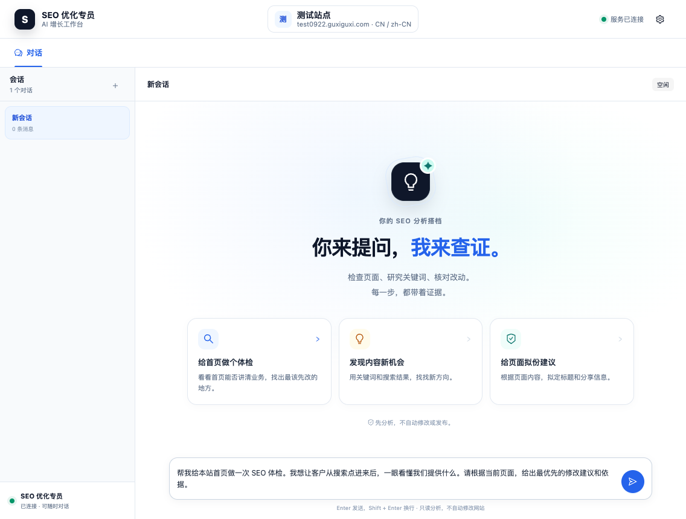

# SEO Diagnosis Agent

用自然语言交代任务，主 Agent 会调度对应的业务专员。你可以继续追问、补充资料，或查看每一步实际用了什么工具。



## 可以问什么

| 业务 | 可以这样问 |
| --- | --- |
| SEO / GEO | 帮我核对这页的标题和正文，给出三条最值得优先修改的建议。 |
| 医药资料 | 查 2025 年关于青少年睡眠时长的三篇 PubMed 文献，附 PMID 和出处。 |
| 学习陪练 | 出三道一元一次方程题，每次只出一道，等我答完再判分。 |
| 报考备考 | 2026 年下半年湖北初中数学教资笔试考哪些科目？帮我列个备考清单。 |
| 随访与复诊准备 | 对照我提供的两次报告，按日期列出变化、原值和来源。 |
| 商旅行程 | 周四从上海去武汉参会，查交通、住宿、接驳和天气，预算 3,500 元。 |
| 购物与采购 | 我要 60 个 200ml 纸杯，按两份报价核算实际要买多少和已知小计。 |

[浏览真实对话截图](docs/screenshots/README.md) · [看医药与 SEO 联查](docs/screenshots/24-healthcare-seo-handoff.png)

## 在工作台查看结果

- **新建对话**支持上传附件或引用知识库文件。选中的资料随本轮一起发送，回复可标注文件和片段出处。单份最多 1 MB，每轮最多 4 份。
- **任务工作台**可以按状态找回原对话。任务等待补充时，在原对话提供条件即可继续。
- **Agent 能力**按业务展示实际注册的工具。**数据源管理**显示本地配置和服务状态。
- **运行中心**显示调用顺序、工具状态与耗时。点开单个工具可查看和复制参数、返回摘要。提示词页的「用户输入」保留原话。[工具明细截图](docs/screenshots/25-trace-tool-details.jpg)

<p>
  
  
</p>

## 本地启动

需要 Python 3.11+、Node.js 20.19+ 或 22.12+，以及 npm。首次启动将 [.env.example](.env.example) 复制为 `.env.local`，设置 `DEEPSEEK_API_KEY`，并让 `DATABASE_URL` 中的口令和 `POSTGRES_PASSWORD` 一致。

```bash
docker compose --env-file .env.local up -d --wait db
sh start.sh
```

打开 [工作台](http://localhost:5173) 或 [API 文档](http://localhost:8000/docs)。现有 PostgreSQL 实例可以通过 `DATABASE_URL` 直接接入。API 默认仅在本机使用。

[工程说明、数据源配置与测试](docs/engineering.md)

## 开源许可

本项目采用 [MIT 许可证](LICENSE)。可选的 HTML 基础扫描复用了 [python-seo-analyzer](https://github.com/sethblack/python-seo-analyzer)。
