# 对话截图

这些截图用已保存的实际运行记录在前端重放。结果图保留用户提问、Agent 回复和对应证据，入口图展示如何发起问题。搜索现状和排名页优化使用 `python.org`，其他案例使用测试站 `test0922.guxiguxi.com`。

搜索查询采用美国市场，指标和排名样本来自第三方数据源。测试站点及部分主题词缺少的数据保留为未知。页面建议待人工确认，截图已遮住内部运行标识。

## 工作流截图

| 对话场景 | 截图 | 工作流代码 |
| --- | --- | --- |
| 首页体检 | [页面证据与检查范围](02-page-audit.png) | [site_audit.py](../../src/seo_agent/workflows/site_audit.py) |
| 搜索现状 | [排名关键词与对应页面](03-search-diagnosis.png) | [search_diagnosis.py](../../src/seo_agent/workflows/search_diagnosis.py) |
| 关键词机会 | [候选词与未知指标](04-keyword-opportunities.png) | [keyword_opportunity.py](../../src/seo_agent/workflows/keyword_opportunity.py) |
| 已有排名页优化 | [排名样本与页面核验](05-ranking-pages.png) | [ranking_page_optimization.py](../../src/seo_agent/workflows/ranking_page_optimization.py) |
| 综合诊断 | [汇总证据与覆盖范围](06-site-diagnosis.png) | [site_diagnosis.py](../../src/seo_agent/workflows/site_diagnosis.py) |
| 页面信息建议 | [TDK 与 OG](07-page-suggestions.png)、[JSON-LD 与待确认项](15-structured-data.png) | [page_suggestions.py](../../src/seo_agent/workflows/page_suggestions.py) |
| 页面分享图 | [对话中的生成图片与页面文案](18-share-image-brief.png) | [share_image.py](../../src/seo_agent/workflows/share_image.py) |
| 页面变更复检 | [保存基线](09-page-review-baseline.png)、[按目标复检](10-page-change-review.png) | [page_change_review.py](../../src/seo_agent/workflows/page_change_review.py) |

首页体检：组合 HTML 核验与移动端性能证据

本次已启用 HTML 基础扫描和 PageSpeed，工作流汇总标题、描述、H1、Canonical 及移动端 Lighthouse 结果：性能 95、无障碍 96、最佳实践 100、SEO 100。证据保留缓存状态；单页实验室结果不代表整站审计、Google 收录状态或真实用户体验。

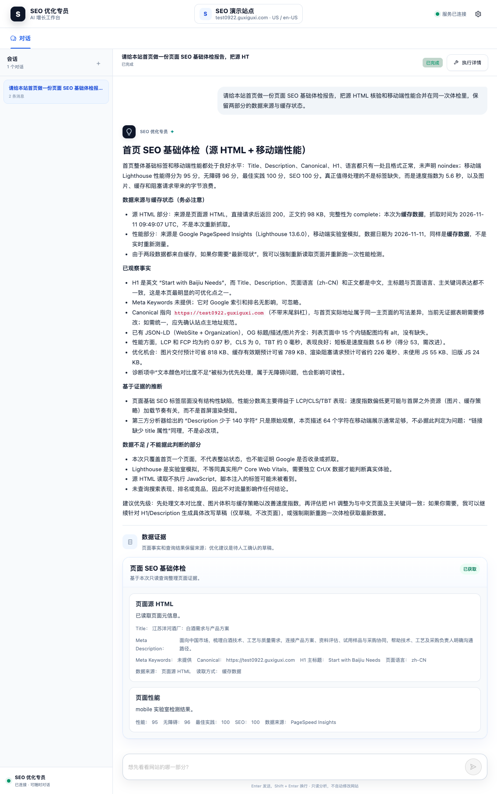

搜索现状：查看关键词、位次和对应页面

本次查询返回 Python 官网的站点指标和 5 条美国市场排名样本。图中展示关键词、位次和对应页面，流量指标为 DataForSEO 的估算值。

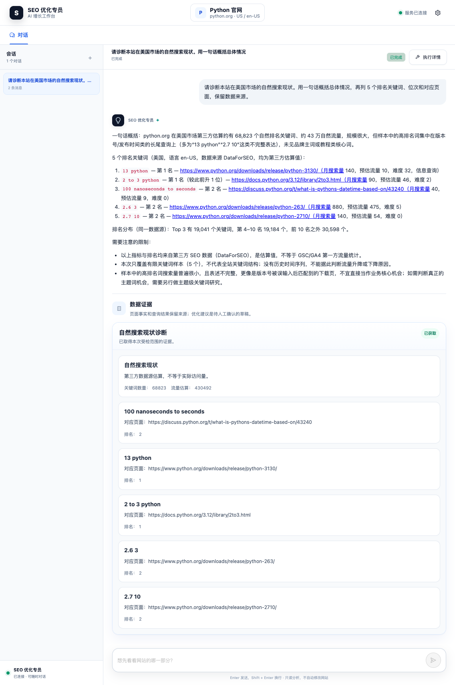

关键词机会：联想词和候选词不等于已批准的业务机会

围绕“白酒选型”查询联想词、指标和主题词 SERP。图中候选词缺少可用的搜索量和难度，保留为未知；只读研究不会入池、审批或创建执行任务。

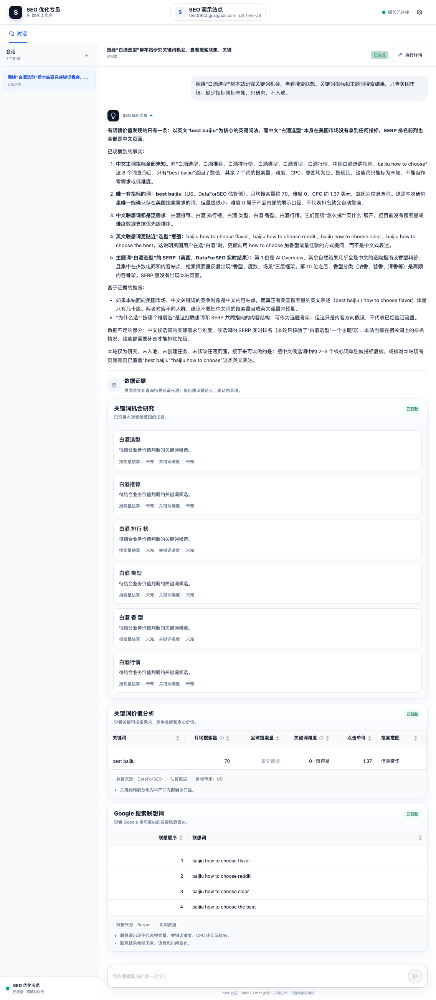

已有排名页优化：从排名样本选页核对

从美国市场第 1–20 名范围的 5 条样本中选 1 个版本发布页，核对源码中的标题、描述和代表词搜索结果。对话保留了第三方排名快照与本次 SERP 的差异，建议限定在受检页面。

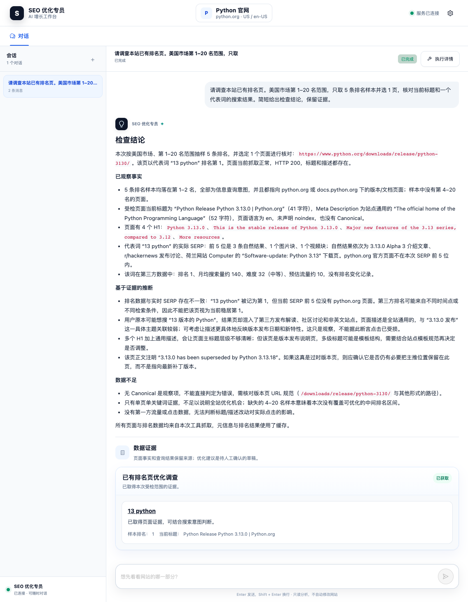

综合诊断：汇总已查证据，同时说明未完成的检查

这张截图记录较早的一次综合诊断。当前工作流也会检查 robots.txt 和 sitemap，结果按实际证据记录；整站爬取和 Google 收录状态仍不在检查范围内。

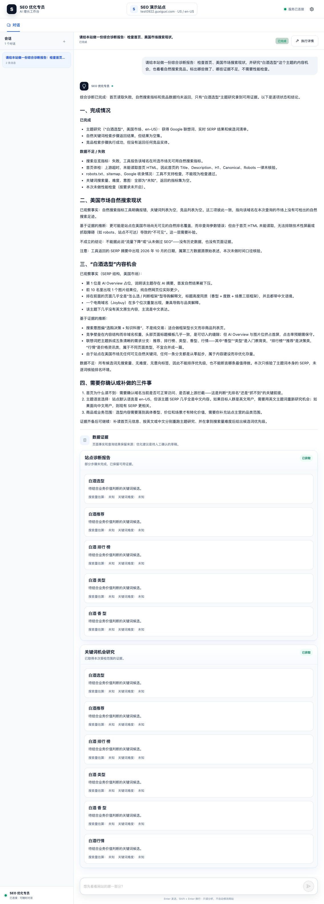

页面信息建议：按当前页面生成 TDK、OG 和 JSON-LD 草稿

使用页面事实和已确认信息拟定标题、描述、主题词、分享信息及结构化数据。主体身份等缺项仍列为待确认，已有 JSON-LD 需人工确认合并；截图不代表通过 Google 富结果测试。

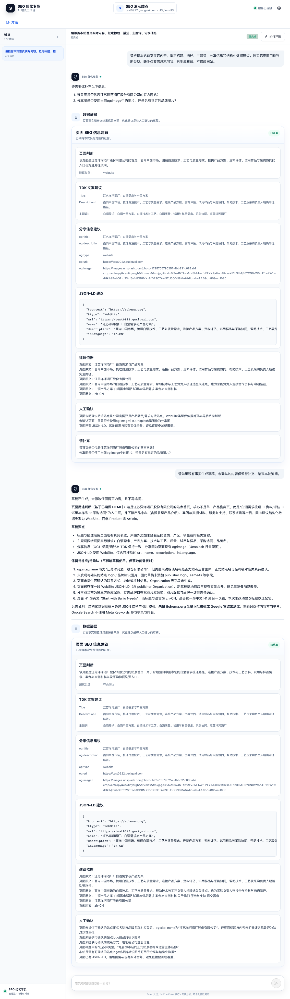

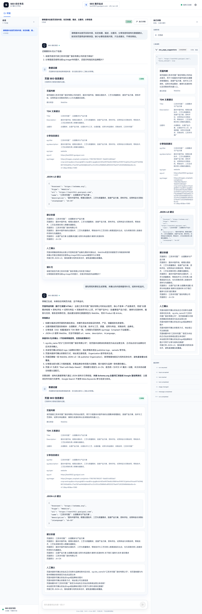

页面分享图：从站点和提问到生成结果

对话保留测试站点、原始提问、Agent 对画面的说明和实际生成的分享图。

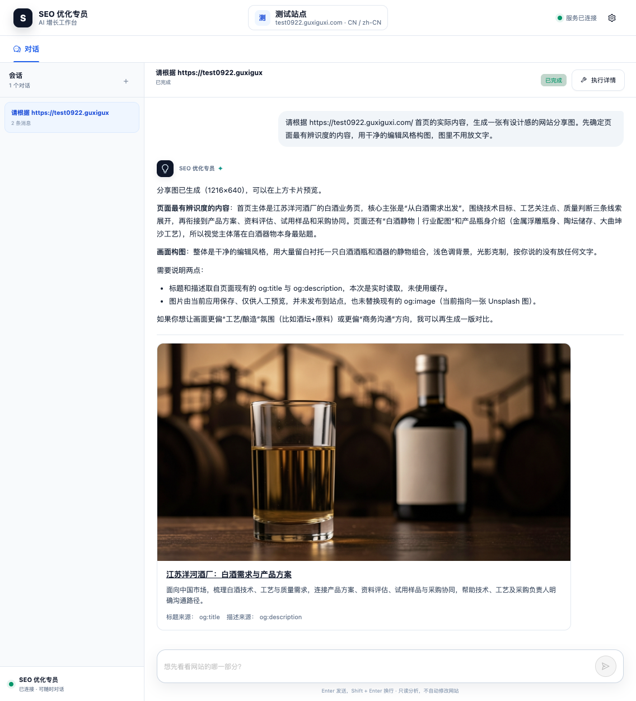

页面变更复检：保存基线，再逐项核对明确目标

先保存页面证据，再重新读取页面并对照给定的 Title、H1 和 Canonical。此次字段与目标一致；过程没有改写网站，也不能证明排名提升。

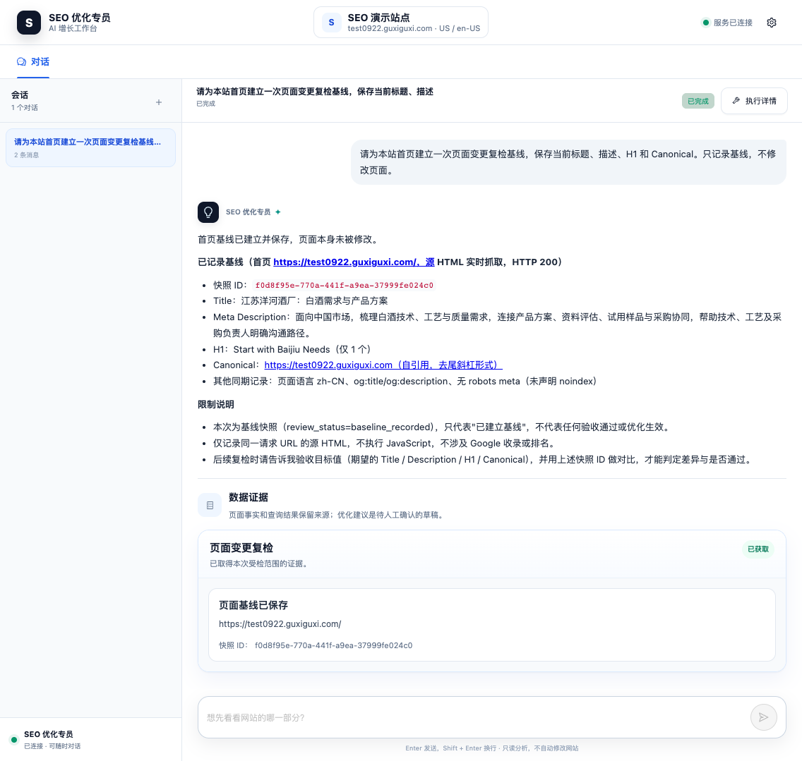

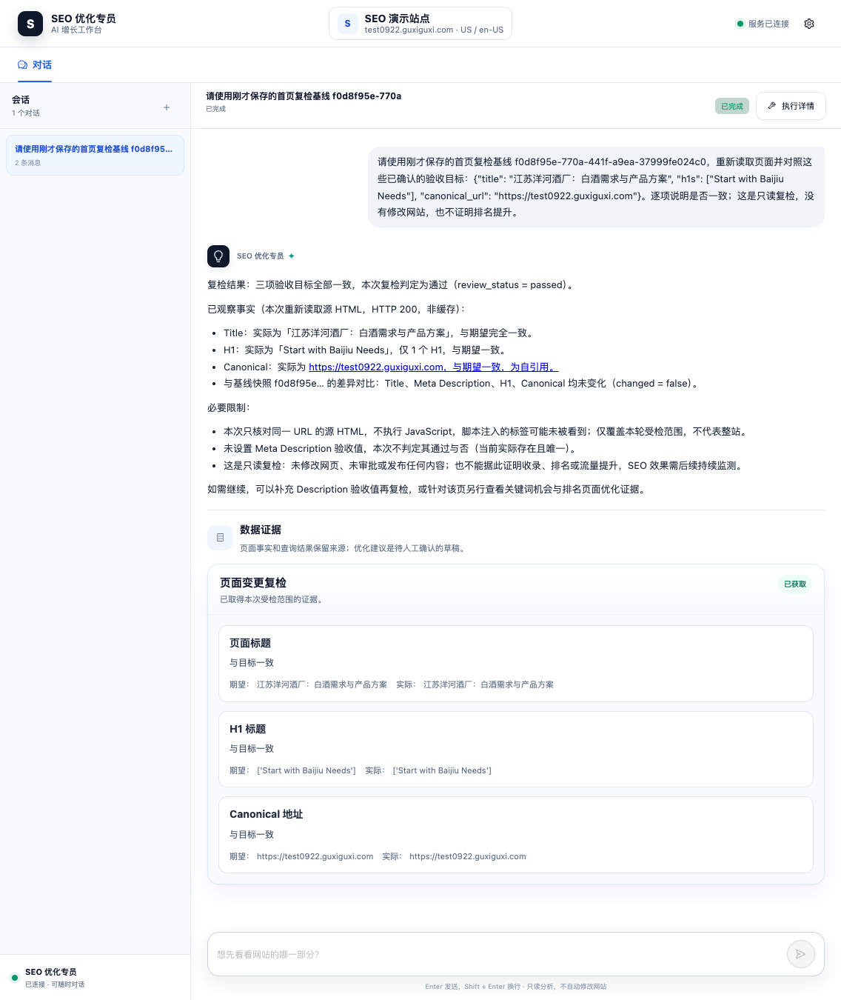

## 对话与人工补充

对话入口：从业务问题开始

入口提供页面体检、关键词机会和页面建议等自然语言示例，点击后填入输入框，由用户发送。

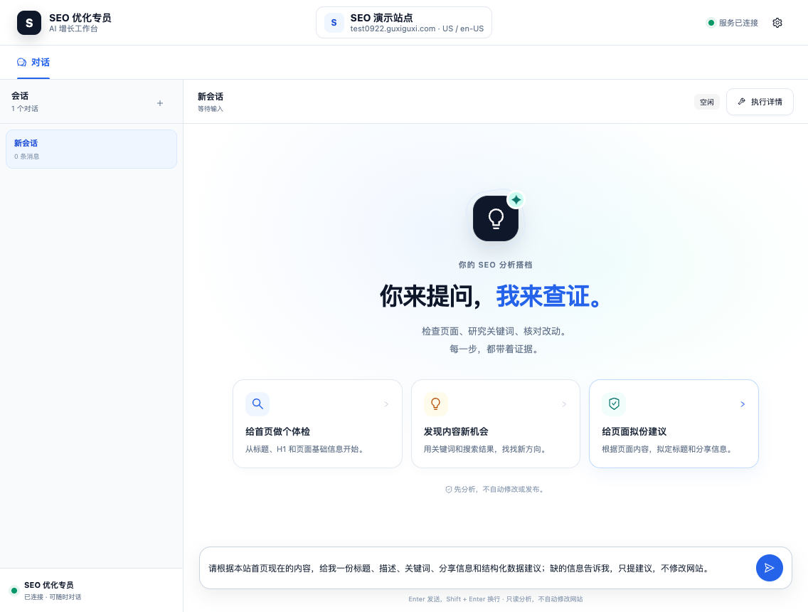

Human-in-the-loop：保存进度，等补充后继续同一次运行

本次页面建议询问主体身份和分享图片，运行进入等待状态。截图中的“先用现有信息生成”由人工显式选择，继续同一个 Run；未确认内容保留为待补充。这一步不代表机会审批。

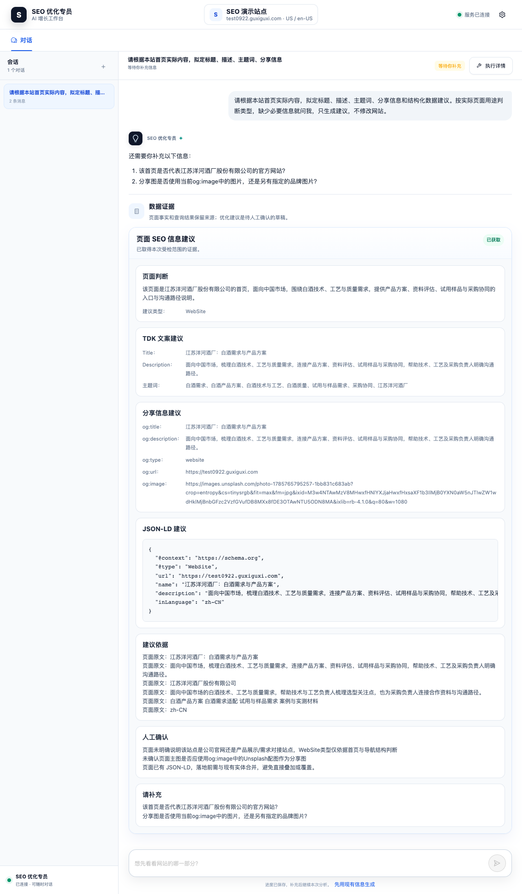

执行详情：查看实际工具、状态、耗时和运行事件

左侧保留原问题、用户选择和最终回复，右侧展示恢复后执行的工具和最近事件。模型输入输出与工作流内部子步骤可按配置上传到 Langfuse。[观测模块](../../src/observability/)

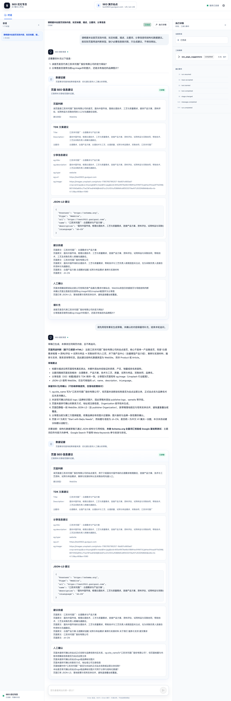

手机端：对话、建议卡片和输入框随屏幕排列

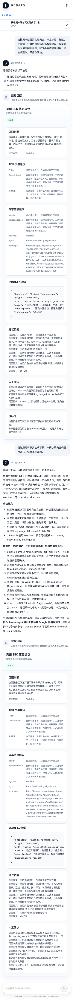

## 其他只读查询

以下是[对话工具注册](../../src/seo_agent/chat/tools.py)中的基础查询，未封装成额外业务工作流。

竞品与外链：保留实际返回范围

本次外链与自然搜索竞品查询未返回可展示条目，界面说明查询范围与数据缺口，不虚构竞品或外链。

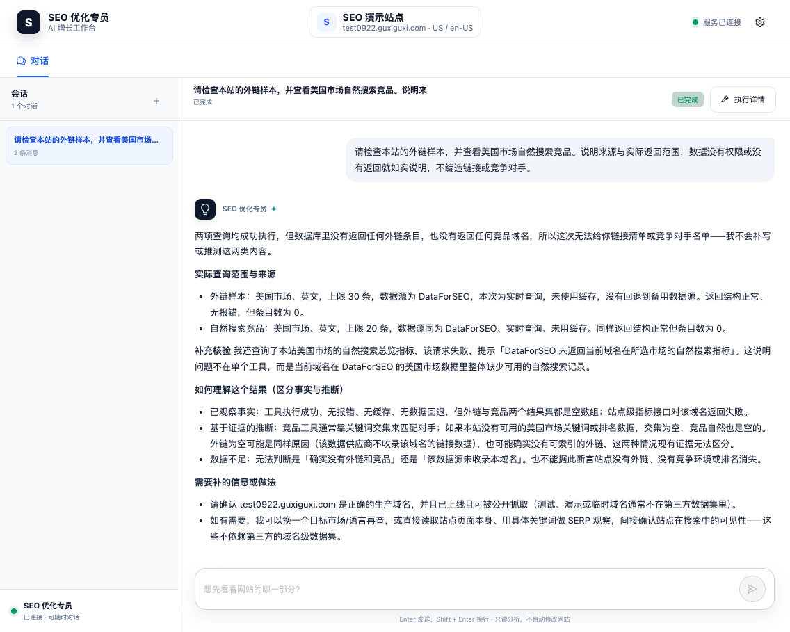

新闻、图片与视频：为内容研究提供搜索线索

同一轮对话查了新闻、图片和视频，保留了搜索结果的标题、链接或缩略图及来源。后两张图同时展示这次对话和相应工具的执行详情。

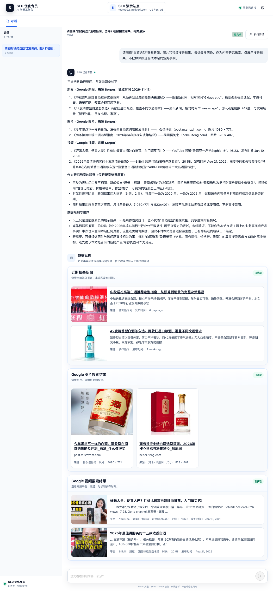

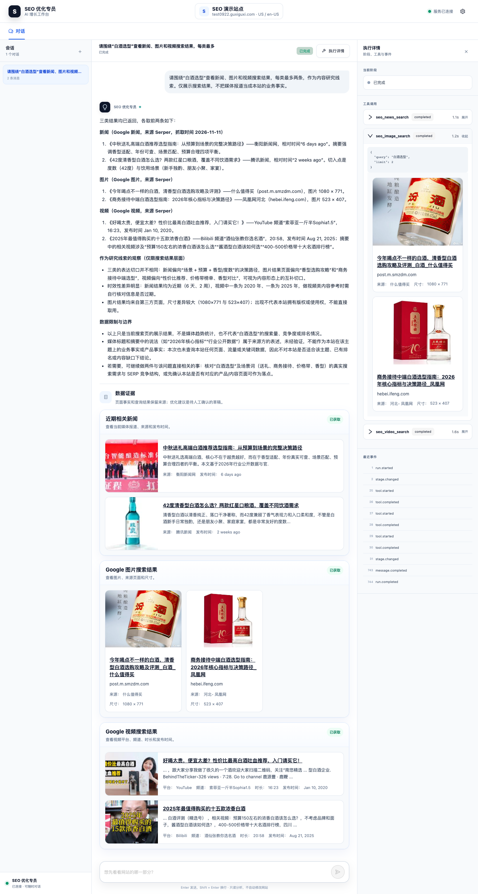

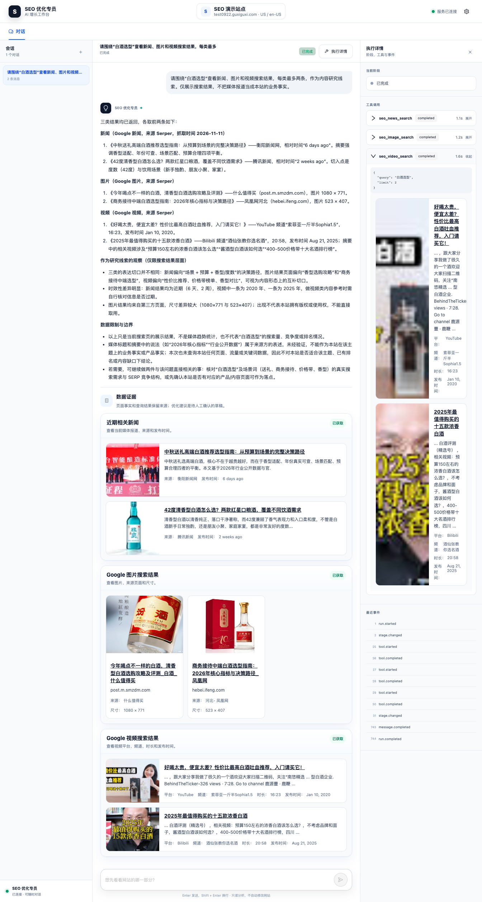

